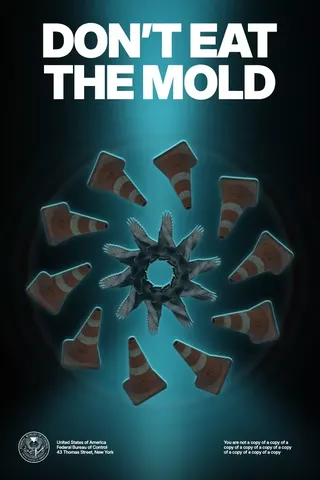
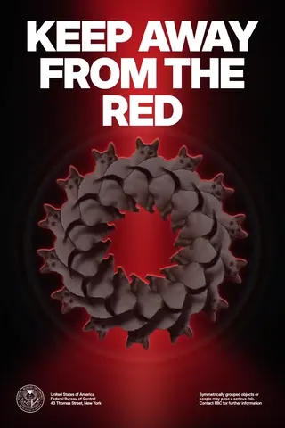

# Patterning

Patterning turns everyday objects into animated kaleidoscopic posters. It's an independent fan project by Seva Shaposhnikov, inspired by the visual language of Remedy Entertainment's CONTROL Resonant.

[Try the live project](https://sevashaposhnikov.com/patterning/)

## Examples

 

## Run locally

From this directory, run:

```sh
python3 -m http.server 8000
```

Open <http://localhost:8000> in a modern browser. The app is a static site with no build step. You can also serve it from a subdirectory, including a GitHub Pages project URL.

## How it works

- Start with a demo or add your own image. A cutout occupies one ring, and each ring repeats its object at equal angles.
- Adjust density, scale, rotation, and element size. Ring overlaps wrap around the circle, and cast shadows stay on the objects.
- Play animates the rings and optical effects. Poster copy is editable on the canvas.
- Export a PNG or a 15-second video. The video format depends on browser support. No color gives PNGs a transparent background.
- Images are processed and saved in your browser. Background removal loads ONNX Runtime Web from jsDelivr when needed. It uses the bundled U²-NetP model, without sending your images to a server.

## Assets and third-party notices

The demo library includes all 22 images generated for Patterning. The example animations were exported from the live site and include its fan-project seal.

- [Inter](https://github.com/rsms/inter) is distributed under the [SIL Open Font License 1.1](assets/inter-license.txt).
- [U²-Net](https://github.com/xuebinqin/U-2-Net) is distributed under [Apache 2.0](assets/MODEL-LICENSE.txt). The bundled ONNX conversion is the [U²-NetP model from the rembg release](https://github.com/danielgatis/rembg/releases/download/v0.0.0/u2netp.onnx). Its SHA-256 is `309c8469258dda742793dce0ebea8e6dd393174f89934733ecc8b14c76f4ddd8`.
- [ONNX Runtime Web](https://github.com/microsoft/onnxruntime) is loaded at runtime and is distributed under the [MIT license](https://github.com/microsoft/onnxruntime/blob/main/LICENSE).
- Remedy Entertainment owns the CONTROL franchise and its associated marks. This project is unaffiliated with Remedy Entertainment and has no official endorsement.

## License

Patterning's source code and sample illustrations are available under the [MIT License](LICENSE). The bundled font and model are distributed under their respective licenses listed above.
